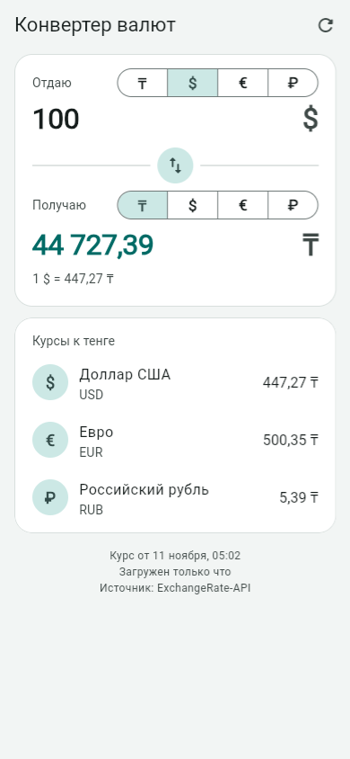
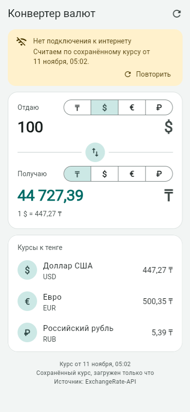
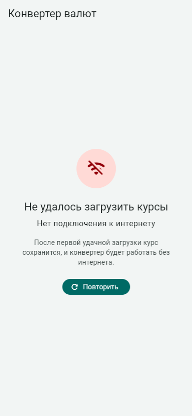

# Конвертер валют

Конвертер тенге, доллара, евро и рубля на Flutter. Курсы загружаются из
бесплатного API, а последний полученный курс сохраняется на устройстве. Поэтому
без интернета приложение продолжает считать и показывает, от какой даты курс.
Работает на Android, Windows и в браузере.

| Онлайн | Нет интернета, есть кэш | Нет интернета, кэша нет |
| --- | --- | --- |
|  |  |  |

## Что внутри

| Тема | Где смотреть |
| --- | --- |
| **Сеть** | `lib/data/rates_api.dart`: GET на [open.er-api.com](https://www.exchangerate-api.com/docs/free) через пакет `http`. Ключ не нужен, курс обновляется раз в сутки, браузер пропускает запрос (CORS открыт). `http.Client` передаётся в конструктор, поэтому в тестах вместо сервера подставляется `MockClient`. В Android-манифесте есть разрешение `INTERNET`, без него release-сборка в сеть не выходит. |
| **Обработка ошибок** | `lib/data/rates_exception.dart`: закрытый (`sealed`) класс `RatesException` с четырьмя случаями: нет соединения, таймаут (10 с), HTTP-ошибка (429 и 5xx с отдельными текстами), некорректный ответ. API превращает любой сбой в один из них, и выше по коду других исключений не бывает. Ответ проверяется через pattern matching: если поля нет или вместо числа пришла строка, это `BadResponseException`, а не падение где-то в интерфейсе. API сообщает о своих ошибках со статусом 200 (`{"result":"error"}`), этот случай тоже обрабатывается. Иконка для каждой ошибки выбирается `switch` по sealed-классу (`lib/widgets/error_icon.dart`): если добавить новый тип ошибки и забыть про него, проект не скомпилируется. |
| **Кэш** | `lib/data/rates_cache.dart`: последний удачный ответ хранится в `SharedPreferences` как JSON (на Android и Windows это файл, в браузере `localStorage`). У ключа есть версия (`rates_cache_v1`). Повреждённая запись удаляется и не мешает дальше. Неудачная загрузка кэш не трогает. |
| **Стратегия загрузки** | `lib/data/rates_repository.dart`: сначала сеть, при ошибке кэш. Наружу отдаются курс, его источник (сеть или кэш) и причина, по которой сеть не сработала. При старте сохранённый курс показывается сразу, а запрос идёт в фоне (`ConverterController.start`). Если нажать «Обновить» дважды, второй запрос не отправляется: оба нажатия ждут первый. При возврате в приложение курс обновляется, если прошлая попытка не удалась или курсу больше часа. |
| **Состояния экрана** | `lib/screens/converter_screen.dart`. Курса ещё нет: индикатор загрузки. Не загрузилось и кэша нет: экран ошибки с кнопкой «Повторить». Есть только кэш: жёлтый баннер с причиной, датой курса и кнопкой «Повторить», а конвертер при этом работает. Внизу всегда указано, от какой даты курс и когда он загружен. Обновить можно кнопкой в шапке или потянув список вниз. |
| **Конвертация** | `lib/models/exchange_rates.dart`: все курсы хранятся относительно доллара, кросс-курс считается как `perUsd[to] / perUsd[from]`. Сумму можно вводить с запятой или с точкой. Числа выводятся по-русски (`44 727,39`), курсы меньше единицы с четырьмя значащими цифрами (`1 ₸ = 0,002236 $`). Выбранная пара и сумма запоминаются. Тап по строке в «Курсах к тенге» подставляет эту валюту в конвертер. |

## Запуск

```sh
flutter pub get
flutter run -d chrome      # или windows / android-устройство
flutter test               # 50 тестов
```

Тесты в сеть не ходят: `FakeServer` (`test/fakes.dart`) отвечает за API. Его
можно переключить на ошибку, неправильный JSON, «зависание» или отключение
сети прямо посреди теста. Проверяются разбор ответа и все виды ошибок, работа
кэша (включая испорченные данные), стратегия «сеть, потом кэш», контроллер и
сам экран во всех трёх состояниях.

Как проверить офлайн-режим вручную: открыть приложение с интернетом, чтобы
курс сохранился, затем отключить сеть (в Chrome: DevTools → Network → Offline)
и нажать ⟳ в шапке приложения. Перезагружать страницу не нужно: без сети
браузер не загрузит и само приложение.

Курсы предоставляет [ExchangeRate-API](https://www.exchangerate-api.com).
